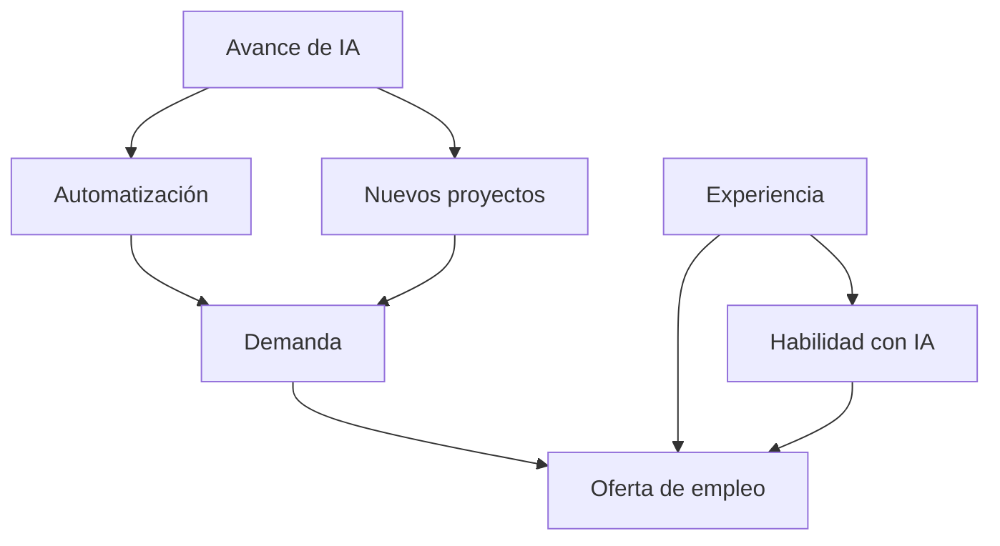

# Modelo: avance de IA y empleo de software en 2031

La pregunta es si un egresado que busca activamente en México recibe al menos
una oferta remunerada de desarrollo de software durante seis meses en 2031.
Es un ejercicio de escenarios: **ninguna CPT está estimada de datos**.
Las fuentes de `INVESTIGACION.md` motivan los factores; los números los
seleccionamos para mostrar cómo funciona la inferencia.

## Eventos y relaciones

| Nodo | Qué significa true |
| --- | --- |
| A | Para el inicio de 2031 existe un agente públicamente accesible que supera 80 % de una evaluación independiente de tareas reales de mantenimiento de software de aproximadamente 8 horas humanas, con requisitos claros, pruebas ocultas y sin ayuda humana durante la resolución. |
| T | En 2031 se automatiza de principio a fin al menos la mitad de las tareas rutinarias de desarrollo del mercado considerado. |
| N | El abaratamiento por IA permite al menos 20 % más proyectos de software que en un escenario comparable sin ese abaratamiento. |
| D | Las vacantes de desarrollo por buscador activo son mayores en 2031 que en 2026. |
| E | El candidato inicia la búsqueda con al menos un año de experiencia remunerada en desarrollo, incluidas prácticas. |
| H | Antes de buscar empleo, supera una evaluación con rúbrica fija de programación, pruebas, depuración y revisión de código generado con IA. |
| O | Recibe al menos una oferta remunerada de software en seis meses de búsqueda activa. |

Los umbrales de 8 horas, 80 %, 50 % y 20 % son elecciones del ejercicio. No son
pronósticos publicados. N compara un escenario contrafactual, por lo que su
medición también requeriría un modelo: no basta contar proyectos.

Aristas: A→T, A→N, T→D, N→D, E→H, D→O, E→O, H→O.

`P(A,T,N,D,E,H,O) = P(A) P(T|A) P(N|A) P(D|T,N) P(E) P(H|E) P(O|D,E,H)`.

La red supone que T y N son independientes dado A, y que el perfil del
candidato no depende de A. Son simplificaciones no verificadas. D resume
el mercado y omite ciclos económicos, inversión, regulación y competencia
internacional. Una flecha representa una dependencia propuesta; no prueba
causalidad con los estudios consultados.

## Todas las tablas: supuestos editables

Cada número es la probabilidad del nodo=true. Para false se usa 1−p.

- P(A)=0.50: punto de referencia de sensibilidad, no confianza científica del 50 %.
- P(E)=0.50: mezcla hipotética de perfiles, no porcentaje observado de egresados.

| A | P(T|A) | P(N|A) |
| --- | --- | --- |
| false | 0.20 | 0.25 |
| true | 0.75 | 0.65 |

Se supone que un avance alto facilita tanto automatizar como emprender proyectos;
ningún resultado es inevitable. A=false tampoco significa que no exista IA.

| T | N | P(D|T,N) |
| --- | --- | --- |
| false | false | 0.55 |
| false | true | 0.85 |
| true | false | 0.20 |
| true | true | 0.60 |

Aquí la automatización presiona a la baja la demanda y los nuevos proyectos la
compensan parcialmente. Esa magnitud es una elección, no una conclusión empírica.

| E | P(H|E) |
| --- | --- |
| false | 0.40 |
| true | 0.70 |

Se supone que la experiencia facilita aprobar, sin ser condición suficiente
ni necesaria. Al consultar un perfil concreto E y H se fijan como evidencia.

| D | E | H | P(O|D,E,H) |
| --- | --- | --- | --- |
| false | false | false | 0.10 |
| false | false | true | 0.30 |
| false | true | false | 0.25 |
| false | true | true | 0.55 |
| true | false | false | 0.35 |
| true | false | true | 0.60 |
| true | true | false | 0.65 |
| true | true | true | 0.85 |

Las ocho filas favorecen experiencia, habilidad y demanda, sin garantizar empleo.
No provienen de porcentajes de BLS, IMCO, Stanford, METR ni WEF.

## Cómo interpretar la salida

- Fijar `A=true` pregunta qué pasa dentro del escenario de avance alto.
- Cambiar `--p-avance 0.8` deja A incierto y le asigna peso 80 %.
- Observar O=false permite actualizar A con Bayes dentro del modelo. No demuestra
  que la IA explique un rechazo real.
- La comparación 20 %, 50 % y 80 % es sensibilidad al prior de A, no un intervalo
  de confianza. También hay que variar las tablas de T, N, D y O: con otras
  magnitudes la IA podría tener un efecto neto distinto.

No se extrapola el crecimiento histórico de capacidades de IA hasta 2031 ni
se convierte crecimiento de puestos, cuota de mercado o intención de contratar
en probabilidad individual de empleo. El motor calcula exactamente el modelo
escrito; eso no implica que el modelo describa con exactitud el futuro.
